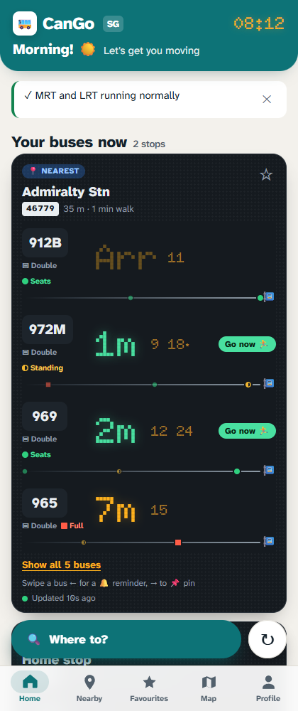
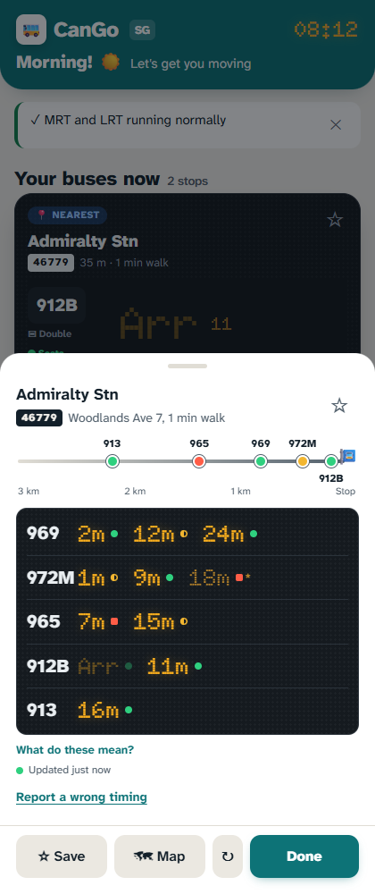
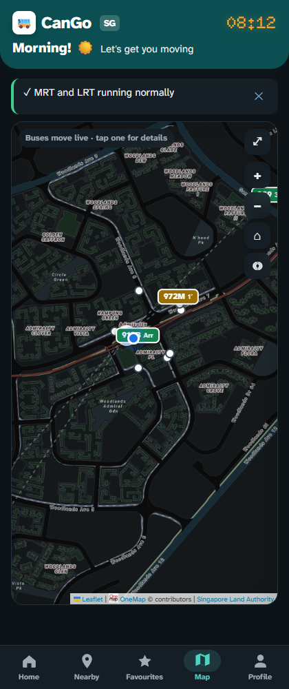
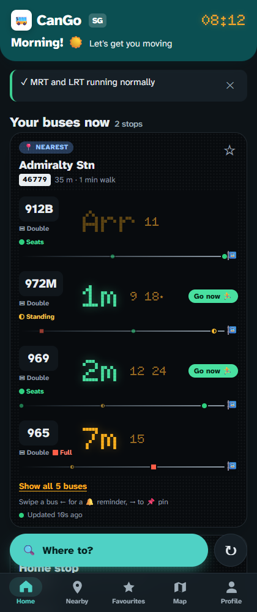

# CanGo SG 🚌

**The fastest way to check Singapore bus times with one hand.** Live arrivals, trip planning, MRT alerts and a live bus map, in a friendly app you can install on your phone. No ads.

**Try it:** https://cangosg.vercel.app

<p>
  
  
  
  
</p>

<sub>Screenshots use demo bus times.</sub>

> The code is public so you can see what I'm building. It is **not** open source: all rights reserved (see [`LICENSE`](LICENSE)).

## Why another bus app?
The most common complaints about Singapore bus apps are wrong timings, intrusive ads, slow or cluttered screens, and clumsy favourites. CanGo SG is built around fixing those:

- **Honest timings.** If a bus's ETA jumps or doesn't match its GPS, it shows a range ("~4–7m") and an *unstable* tag instead of a falsely precise number. A banner appears when LTA's timing feed looks down. Every board shows a live "Updated 12s ago" dot.
- **Readable in under 2 seconds.** Huge LED-style countdowns, green when the bus is ≤ 2 min away, plus bus type (single, double, bendy) and crowding.
- **One-handed.** Bottom tab bar, a "Where to?" button in thumb reach, bottom sheets and swipe gestures. Nothing important in the top corners.
- **Accessible.** Crowding uses shape *and* colour (● seats, ◐ standing, ■ full) for colourblind users. Larger text option, wheelchair-accessible bus marking, reduced-motion support, light and dark mode.
- **No ads.** Ever, in the free version.

## Features
**Home: "Your buses now"**
- Your nearest stop first, then the stops you've saved, as big live countdown boards
- Swipe a bus ← for a 🔔 reminder, → to 📌 pin it (or press and hold the bus number). Pinned buses show first
- "Go now 🏃" when it's time to walk to the stop

**Stops and map**
- Tap any stop for a bottom sheet with the full arrival board and an approach strip of buses heading your way
- Live map with buses that glide towards the stop between updates. Tap a bus for "3 min · seats available · double deck"

**Trip planner ("Where to?")**
- Bus + MRT or bus-only routes, with Now / Leave at / Arrive by and a one-tap "📍 Here" for your current location
- MRT strip-map steps in official line colours, fares, crowd levels and a crowd forecast for train legs
- Tap a part of the route on the map to highlight it. Traffic incident warnings on bus legs
- Disruption mode puts routes that avoid a broken MRT line first. Rain mode prefers less walking

**On the move**
- **Ride mode:** follows your trip step by step and buzzes "get off at the next stop"
- **Reminders:** "buzz me when bus 969 is 2 min away"
- **My commute:** save Home and Work for a one-tap best route and leave time

**Personal**
- Favourites you can reorder and nickname ("Home stop"), saved places, trip history with monthly stats
- Accent colours (Teal, Orchid, Marina, Sunset), friendly copy and little Singapore illustrations
- Installable (PWA), opens instantly, works offline with the last saved timings

## Built with
- Plain HTML, CSS and JavaScript: no framework, fast to load
- [Leaflet](https://leafletjs.com/) maps with [OneMap](https://www.onemap.gov.sg/) tiles
- Serverless API on [Vercel](https://vercel.com/) that keeps the API keys off the phone
- Data from [LTA DataMall](https://datamall.lta.gov.sg/) (bus arrivals, stops, MRT alerts, crowding, traffic), OneMap (search and routing) and data.gov.sg (weather)
- Built with help from Claude (Anthropic)

## Project layout
```
public/        the app: index.html (page + styles), app.js, sw.js (offline), icons
api/           serverless functions: arrivals, route, search, alerts, traffic, crowd, weather…
scripts/       build-stops.mjs (bus stop list, built on deploy), local-server.mjs (local preview)
docs/          screenshots
CHANGELOG.md   every change, in plain language
```

## Progress
See [`CHANGELOG.md`](CHANGELOG.md) for everything built so far. Next up: a native app with Expo (lock-screen countdowns, widgets, alerts with the phone locked).
